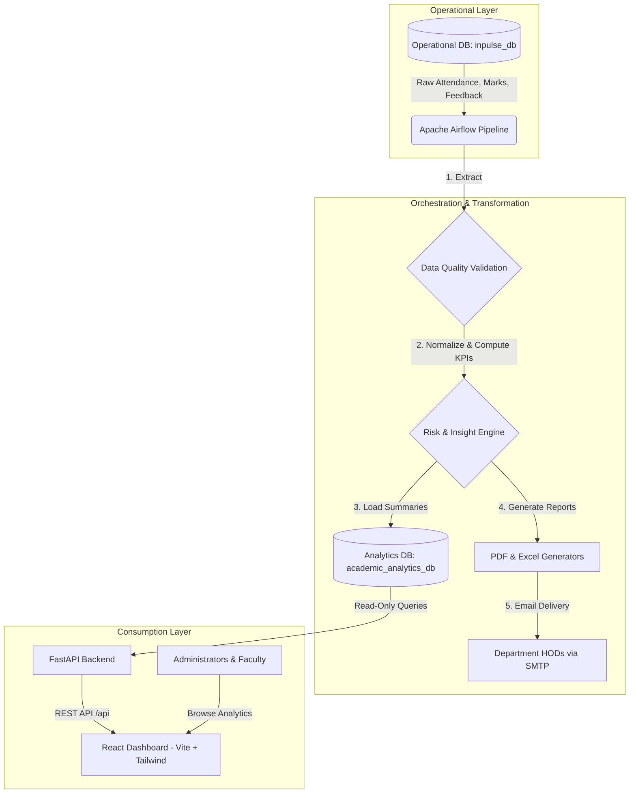

# InPulse Academic Intelligence Platform

<p align="center">
  
</p>

<p align="center">
  <strong>Raw Academic Data &rarr; Automated ETL &rarr; Risk Intelligence &rarr; Interactive Dashboards &rarr; Weekly Executive HOD Reports</strong>
</p>

<p align="center">
  <a href="https://github.com/armanraj02/impulse"></a>
  
  
  
  
  
  
  
</p>

---

## 📑 Table of Contents
- [Project Overview](#-project-overview)
- [Key Features](#-key-features)
- [System Architecture](#-system-architecture)
- [Repository Structure](#-repository-structure)
- [Technology Stack](#-technology-stack)
- [Quick Start Guide](#-quick-start-guide)
- [Service Endpoints & Dashboard URLs](#-service-endpoints--dashboard-urls)
- [Data Pipeline & Airflow Workflow](#-data-pipeline--airflow-workflow)
- [Security & Isolation Model](#-security--isolation-model)
- [Synthetic Data Generation](#-synthetic-data-generation)
- [Testing & Quality Assurance](#-testing--quality-assurance)
- [Architecture Documentation & Assets](#-architecture-documentation--assets)

---

## 🎯 Project Overview

The **InPulse Academic Intelligence Platform** is an enterprise-grade, end-to-end data analytics and automated reporting ecosystem. It transforms raw academic operational data into actionable intelligence for department Heads of Department (HODs), institutional deans, faculty, and administrators.

Traditional higher education institutions often suffer from siloed attendance, examination, and feedback systems. **InPulse** bridges this gap by automatically extracting, validating, transforming, and scoring student and departmental metrics on a scheduled weekly cadence, producing:
1. **Interactive Analytics Dashboards** (React + Vite + Recharts) for live exploration of departmental health, batch/section performance, and student risk profiles.
2. **Automated Weekly Executive HOD Reports** (formatted PDF and multi-tab Excel files) delivered directly to department heads via SMTP.

---

## ✨ Key Features

- **Decoupled 2-Tier Database Design:** Strict physical separation between operational transactional records (`inpulse_db`) and processed analytical data (`academic_analytics_db`).
- **Automated Airflow Orchestration:** Scheduled Saturday execution with task retries, data quality validations, error alerts, and Celery distributed workers.
- **Automated Risk Engine:** Multi-factor scoring that flags students at academic risk (&lt; 60%), attendance risk (&lt; 75%), or composite critical risk.
- **Department-Specific Reporting:** Generates customized PDF reports and styled multi-sheet Excel workbooks for CSE, AIML, ISE, ECE, and ME.
- **Automated Email Dispatch:** Secure SMTP delivery to department HODs with delivery status tracking (`report_deliveries`) and built-in safe dry-run mode.
- **High-Performance Read-Only API:** FastAPI backend strictly connected using a restricted `analytics_readonly` role without write or schema permissions.
- **Responsive Web Dashboard:** Modern SPA featuring KPIs, course feedback correlation, department comparison charts, and risk drill-downs.

---

## 🏗 System Architecture

The platform follows a clean, layered data processing architecture:



### Architectural Principles
1. **Read-Only Analytics Serving:** The frontend and FastAPI backend have **zero access** to the operational `inpulse_db`.
2. **Deterministic Metric Generation:** KPIs and insights are generated via repeatable rules and verified through automated Data Quality (DQ) checks.
3. **Graceful Degradation:** Weekly report delivery records are logged in `report_deliveries` with transactional integrity.

For the complete architectural specification, refer to [architecture.md](architecture.md).

---

## 📁 Repository Structure

```
impulse/
├── assets/
│   ├── architecture_diagram.png   # Full-resolution platform architecture diagram
│   └── main_data_eng.pdf          # Vector PDF architecture specification
├── backend/
│   ├── app/
│   │   ├── api/                   # FastAPI endpoint routes
│   │   ├── models/                # SQLAlchemy ORM models
│   │   ├── config.py              # Environment configuration & Pydantic settings
│   │   ├── database.py            # Read-only database session & engine
│   │   └── main.py                # FastAPI entry point
│   ├── tests/
│   │   └── test_api.py            # API test suite (health, overview, departments, pagination)
│   ├── Dockerfile                 # Backend container definition
│   └── requirements.txt           # Python dependencies for API
├── frontend/
│   ├── src/                       # React 19 SPA source code (components, pages, charts)
│   ├── public/                    # Static assets & icons
│   ├── Dockerfile                 # Multi-stage production build (Node -> Nginx)
│   ├── nginx.conf                 # Nginx reverse proxy configuration
│   ├── package.json               # Frontend dependencies & scripts
│   └── vite.config.ts             # Vite build & dev-proxy configuration
├── dags/
│   ├── lib/                       # Pipeline modules:
│   │   ├── weekly_academic.py     # Academic data extraction
│   │   ├── weekly_attendance.py   # Attendance KPI calculations
│   │   ├── weekly_feedback.py     # Course & instructor feedback aggregation
│   │   ├── weekly_insights.py     # Deterministic insight generator
│   │   ├── weekly_summary_v2.py   # Departmental metric compilation
│   │   ├── weekly_pdf.py          # ReportLab PDF report generator
│   │   ├── weekly_excel.py        # Multi-tab OpenPyXL Excel workbook builder
│   │   ├── weekly_email.py        # SMTP email composition and attachment delivery
│   │   └── pipeline_monitoring.py # Run logging & failure tracking
│   ├── generalized_weekly_hod_pipeline.py  # Primary Apache Airflow DAG
│   ├── setup_readonly_db.py       # Helper to initialize read-only database roles
│   └── check_db.py                # Database connectivity inspection
├── scripts/
│   ├── maindata.py                # Synthetic raw operational data generator
│   ├── export_csv.py              # CSV data exporter
│   ├── create_index.py            # Delivery index optimization script
│   └── update_constraint.py       # Pipeline run status constraint migrator
├── notebooks/
│   ├── maindata.ipynb             # Exploratory data analysis & generator notebook
│   └── maindata_csv.ipynb         # CSV exploration notebook
├── reports/                       # Generated sample PDF & Excel HOD report artifacts
├── docker-compose.yaml            # Complete multi-service orchestration (Airflow, DB, API, UI)
├── Dockerfile                     # Custom Airflow container image
├── requirements.txt               # Airflow extra requirements
├── .env.example                   # Environment configuration template
├── .gitignore                     # Git ignore rules (secrets, caches, builds)
├── architecture.md                # System architecture documentation
└── README.md                      # Project documentation
```

---

## 🛠 Technology Stack

| Layer | Technologies |
|---|---|
| **Pipeline & Orchestration** | Apache Airflow 3.1.7, CeleryExecutor, Redis 7.2 |
| **Databases** | PostgreSQL 16 (`inpulse_db` & `academic_analytics_db`) |
| **Backend API** | FastAPI, SQLAlchemy 2, Pydantic v2, Uvicorn |
| **Frontend UI** | React 19, TypeScript, Vite 8, TailwindCSS, Recharts, Lucide React |
| **Report Generation** | ReportLab (PDF), OpenPyXL (Excel), smtplib |
| **Synthetic Data & ETL** | Pandas, Faker, Psycopg2, Psycopg 3 |
| **Containerization** | Docker, Docker Compose, Nginx Alpine |

---

## 🚀 Quick Start Guide

### 1. Prerequisites
- [Docker](https://docs.docker.com/get-docker/) & [Docker Compose](https://docs.docker.com/compose/)
- [Node.js](https://nodejs.org/) v20+ *(Optional, for standalone frontend development)*
- [Python](https://www.python.org/) 3.11+ *(Optional, for standalone backend testing)*

### 2. Clone the Repository
```bash
git clone https://github.com/armanraj02/impulse.git
cd impulse
```

### 3. Configure Environment Variables
Copy the template `.env.example` to `.env`:
```bash
cp .env.example .env
```
Update `.env` with your desired configuration (the defaults work out of the box for local Docker execution).

> **Security Note:** Never commit `.env` containing real passwords or SMTP credentials to Git. `.env` is ignored by `.gitignore`.

### 4. Launch with Docker Compose
Start the complete platform in detached mode:
```bash
docker compose up -d
```

Verify that all services are healthy and running:
```bash
docker compose ps
```

---

## 🌐 Service Endpoints & Dashboard URLs

| Service | URL | Description |
|---|---|---|
| **Frontend Dashboard** | [http://localhost:3000](http://localhost:3000) | Interactive React analytics dashboard |
| **Airflow Web UI** | [http://localhost:8082](http://localhost:8082) | Airflow DAG management & execution logs (User: `airflow`, Pass: `airflow`) |
| **FastAPI Swagger Docs** | [http://localhost:8000/docs](http://localhost:8000/docs) | Interactive API documentation & schema explorer |
| **FastAPI Health Check** | [http://localhost:8000/health](http://localhost:8000/health) | API health check endpoint |
| **PostgreSQL Database** | `localhost:5432` | Postgres server (`inpulse_db` & `academic_analytics_db`) |
| **Redis Cache** | `localhost:6379` | Celery broker for distributed Airflow workers |

---

## ⚙️ Data Pipeline & Airflow Workflow

The core data pipeline is orchestrated by `generalized_weekly_hod_pipeline`:
- **Schedule:** Every Saturday at 08:00 AM (Asia/Kolkata).
- **Execution Target:** All active academic departments (`CSE`, `AIML`, `ISE`, `ECE`, `ME`).

### Pipeline Stages
1. **Extract & Validate:** Extracts raw records from `inpulse_db` and verifies data completeness and referential integrity.
2. **Transform & Normalize:** Aggregates attendance records, assessment marks, and student feedback scores.
3. **Compute KPIs:** Calculates department, batch, and section-level averages.
4. **Risk Classification:** Evaluates threshold criteria:
   - *Attendance Risk:* Attendance &lt; 75%
   - *Academic Risk:* Average score &lt; 60%
   - *Critical Risk:* Both conditions met
5. **Insight Generation:** Evaluates deterministic rules to suggest actionable interventions for HODs.
6. **Populate Analytics DB:** Refreshes summarized tables in `academic_analytics_db`.
7. **Report Generation:** Generates department-specific `.pdf` and `.xlsx` artifacts in `reports/`.
8. **Email Delivery:** Dispatches emails with attached reports to each HOD (set `SMTP_DRY_RUN=false` in `.env` to enable live sending).

### Triggering the Pipeline Manually
```bash
docker compose exec airflow-scheduler airflow dags trigger generalized_weekly_hod_pipeline
```

Check the execution runs:
```bash
docker compose exec airflow-scheduler airflow dags list-runs -d generalized_weekly_hod_pipeline
```

---

## 🔒 Security & Isolation Model

- **Least Privilege Access:** The backend connects using the dedicated `analytics_readonly` role with `SELECT`-only privileges on `academic_analytics_db`.
- **Zero Infiltration to Source Data:** The API layer and frontend have no network routing or credentials for `inpulse_db`.
- **Safe Email Dry-Run:** By default, `SMTP_DRY_RUN=true` prevents emails from being sent to real addresses during testing and development.
- **Credential Sanitization:** All sample scripts and configurations utilize environment variable overrides instead of hardcoded values.

---

## 🧪 Synthetic Data Generation

To populate or reset test academic data in `inpulse_db`:
```bash
python scripts/maindata.py
```
This script generates realistic synthetic records using deterministic random seeds (students, departments, enrollments, assessment scores, attendance, and feedback).

---

## 🧪 Testing & Quality Assurance

Run the automated backend test suite:
```bash
# Inside Docker:
docker compose exec backend pytest -q tests/

# Locally (if backend venv is active):
cd backend
pytest -v tests/
```

Run Airflow DAG integrity checks:
```bash
docker compose exec airflow-scheduler airflow dags list-import-errors
```

---

## 📖 Architecture Documentation & Assets

- **Architecture Specification:** [architecture.md](architecture.md)
- **High-Resolution Diagram:** [assets/architecture_diagram.png](assets/architecture_diagram.png)
- **Vector PDF Diagram:** [assets/main_data_eng.pdf](assets/main_data_eng.pdf)

---

## 👥 Authors & Maintainers

- **Arman Raj** - [@armanraj02](https://github.com/armanraj02)
- **Repository:** [https://github.com/armanraj02/impulse](https://github.com/armanraj02/impulse)
