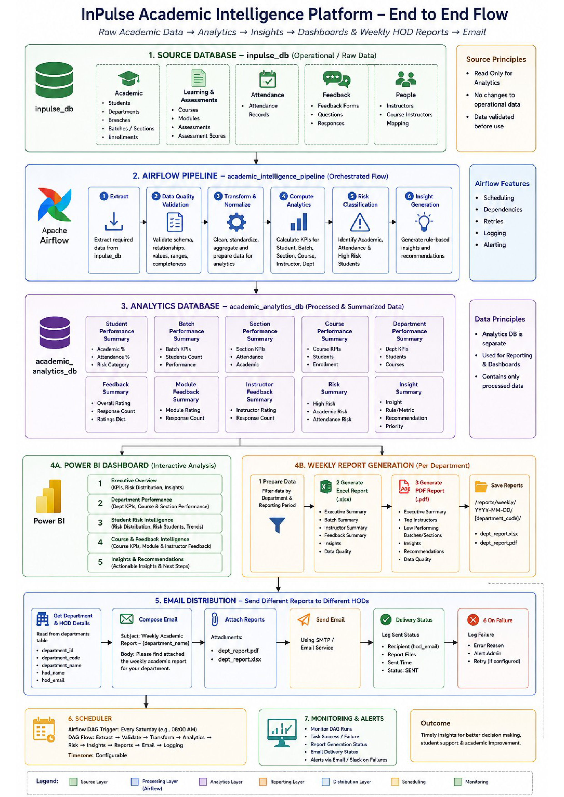

# InPulse System Architecture & Data Engineering Specification

<p align="center">
  
</p>

## 1. Executive Summary

The **InPulse Academic Intelligence Platform** is built upon a modern, distributed data engineering architecture designed to provide academic institutions with scalable, reliable, and decoupled analytics. 

The architecture strictly isolates high-frequency operational transactions (attendance tracking, exam evaluation, student feedback) from downstream analytical query workloads and automated reporting pipelines.

---

## 2. Architectural Pillars

1. **Physical Database Isolation:**
   - **`inpulse_db` (Operational / Raw OLTP):** Stores mutable institutional data, attendance logs, assessment submissions, and pipeline delivery audits. Read-only for analytical pipelines.
   - **`academic_analytics_db` (Analytical OLAP Warehouse):** Stores denormalized, pre-aggregated summaries, KPI metrics, risk classifications, and insight payloads.

2. **Automated Orchestration via Apache Airflow:**
   - Scalable workflow engine utilizing the `CeleryExecutor` with Redis message brokering.
   - Built-in data quality validation, automated retry policies, dependency management, and monitoring.

3. **Multi-Channel Insight Distribution:**
   - **Interactive Web Client:** Modern React 19 Single Page Application consuming a FastAPI REST microservice.
   - **Weekly Push Reporting:** Head of Department (HOD) customized PDF and Excel workbooks dispatched via SMTP every Saturday morning.

---

## 3. End-to-End Data Pipeline Flow

```
[Operational Source]       [Data Pipeline]             [Analytics Warehouse]       [Consumption]
   inpulse_db       -->   Apache Airflow         -->   academic_analytics_db   -->   FastAPI Backend
(Students, Courses,      (Extract, Validate,         (Performance, Risk,         (Read-Only REST)
 Attendance, Marks,       Transform, Compute,         Feedback, Insights)               |
 Feedback)                Generate Reports)                                            v
                                 |                                              React Dashboard
                                 v                                             (Visual Analytics)
                          [Email Engine]
                        (PDF & Excel to HODs)
```

### Stage 1: Extraction & Ingestion
- Ingestion occurs from `inpulse_db` targeting the prior academic reporting cycle (default: Monday to Sunday boundary).
- Extracts student records, enrollments, class attendances, course modules, assessment scores, and feedback questionnaires.

### Stage 2: Data Quality & Integrity Validation
- Verifies referential integrity across students, courses, sections, and departments.
- Checks completeness and range validity (e.g., attendance percentage $\in [0, 100]$, scores within valid weightages).
- Logs pipeline run status in `pipeline_runs` (`RUNNING`, `SUCCESS`, `PARTIAL_SUCCESS`, `FAILED`).

### Stage 3: Transformation & Normalization
- Flattens relational schemas into analytical datasets.
- Imputes missing assessments or marks with appropriate handling.
- Computes aggregate metrics at the student, section, batch, course, and department tiers.

### Stage 4: Risk Classification & Anomaly Detection
- **Academic Risk:** Identified when average performance drops below 60%.
- **Attendance Risk:** Identified when student attendance drops below 75%.
- **Critical Risk:** Identified when both attendance and academic scores fall below thresholds.
- Populates `student_performance_summary` and `risk_summary`.

### Stage 5: Rule-Based Insight Generation
- Evaluates deterministic business rules to generate actionable recommendations for department leaders (e.g., faculty interventions, student counseling triggers, course pacing adjustments).
- Stores structured insights in `insight_summary`.

### Stage 6: Analytical Database Refresh
- Atomically writes analytical snapshots into `academic_analytics_db` using safe upsert operations.

### Stage 7: Automated Report Generation & Delivery
- **Excel Report (`.xlsx`):** Generated using OpenPyXL with stylized multi-tab layouts (Executive Summary, Batch Breakdown, Risk Roster, Feedback Analysis).
- **PDF Report (`.pdf`):** Generated using ReportLab with institutional branding, KPI tables, and department summaries.
- **SMTP Distribution:** Emails reports to each department's HOD with delivery verification logged in `report_deliveries`.

---

## 4. Database Schema Specifications

### Operational Database: `inpulse_db`
- `departments`: Department metadata and HOD contact details.
- `students`: Demographic information, USN, batch, and section mapping.
- `courses` & `modules`: Curriculum hierarchy and subject definitions.
- `assessments` & `assessment_scores`: Evaluation schemes, maximum marks, and student test scores.
- `attendance`: Date-stamped attendance logs per session.
- `feedback_forms`, `questions`, `responses`: End-of-module and periodic course feedback.
- `pipeline_runs`: Airflow execution logs, duration, status, and error traces.
- `report_deliveries`: Delivery audit tracking (department, report week, timestamps, status, retry counts).

### Analytical Warehouse: `academic_analytics_db`
- `department_performance_summary`: Aggregate department-level KPIs.
- `student_performance_summary`: Student-level attendance, score averages, and risk status.
- `batch_performance_summary`: Cohort-level statistics across academic years.
- `section_performance_summary`: Granular section comparison metrics.
- `course_performance_summary`: Pass rates, average scores, and attendance by subject.
- `feedback_summary`: Departmental sentiment and numerical rating distributions.
- `module_feedback_summary`: Detailed module-level feedback scores.
- `instructor_feedback_summary`: Instructor evaluation metrics.
- `risk_summary`: Active list of high-risk students requiring immediate intervention.
- `insight_summary`: Actionable automated recommendations generated by the pipeline.

---

## 5. Security & Boundary Enforcement Matrix

| Component | Target Database | Role | Permissions | Security Guarantees |
|---|---|---|---|---|
| **Airflow Pipeline** | `inpulse_db` | `postgres` / ETL | `SELECT`, `INSERT` (logging) | Reads raw operational data; writes execution audit logs |
| **Airflow Pipeline** | `academic_analytics_db` | `postgres` / ETL | Full DDL/DML | Builds, refreshes, and updates analytical warehouse tables |
| **FastAPI Backend** | `academic_analytics_db` | `analytics_readonly` | `SELECT` ONLY | Strictly prohibited from `INSERT`, `UPDATE`, `DELETE`, or `ALTER` |
| **FastAPI Backend** | `inpulse_db` | None | **NO ACCESS** | Network and credential isolation ensures zero read or write capability |
| **React Dashboard** | Backend API | HTTP Client | JSON REST API | No direct SQL access; all requests filtered and paginated through FastAPI |

---

## 6. Docker Container Orchestration

The platform infrastructure is orchestrated via Docker Compose:

```
┌─────────────────────────────────────────────────────────────┐
│                       Docker Host                           │
│                                                             │
│  ┌───────────────────────┐       ┌───────────────────────┐  │
│  │   PostgreSQL 16       │       │   Redis 7.2 Broker    │  │
│  │   Port: 5432          │       │   Port: 6379          │  │
│  └───────────▲───────────┘       └───────────▲───────────┘  │
│              │                               │              │
│  ┌───────────┴───────────────────────────────┴───────────┐  │
│  │                Airflow Cluster                        │  │
│  │  - airflow-scheduler                                  │  │
│  │  - airflow-worker (Celery)                            │  │
│  │  - airflow-triggerer                                  │  │
│  │  - airflow-dag-processor                              │  │
│  │  - airflow-webserver (Port: 8082)                     │  │
│  └───────────────────────┬───────────────────────────────┘  │
│                          │ Populates                        │
│                          v                                  │
│              academic_analytics_db                          │
│                          │ Read-Only Queries                │
│                          v                                  │
│  ┌───────────────────────────────────────────────────────┐  │
│  │   FastAPI Backend (Port: 8000)                        │  │
│  └───────────────────────▲───────────────────────────────┘  │
│                          │ Reverse Proxy /api               │
│  ┌───────────────────────┴───────────────────────────────┐  │
│  │   React + Nginx Frontend (Port: 3000)                 │  │
│  └───────────────────────────────────────────────────────┘  │
└─────────────────────────────────────────────────────────────┘
```

---

## 7. Architecture Assets

- **High-Resolution Architecture Diagram:** [assets/architecture_diagram.png](assets/architecture_diagram.png)
- **Vector PDF Architecture Specification:** [assets/main_data_eng.pdf](assets/main_data_eng.pdf)
